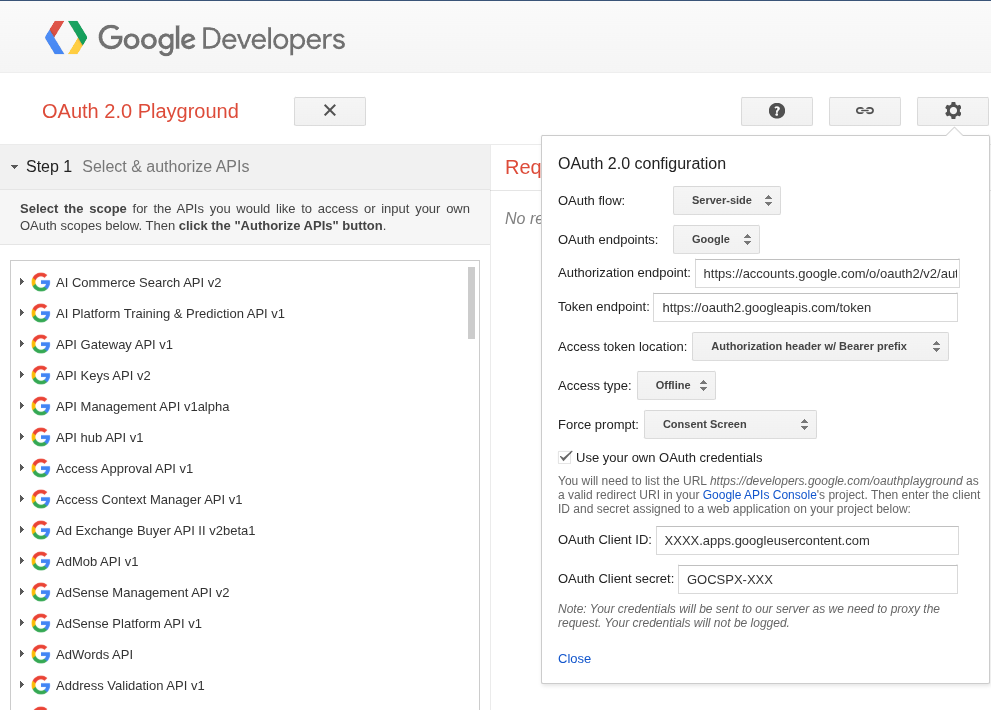

# Storage Volumes

Storage volumes are the destinations where your backup files are stored. Databasement supports multiple storage backends to fit your infrastructure needs.

:::tip
Secrets (passwords, access keys, client secrets and tokens) are encrypted at rest in the database using Laravel's encryption. They are never stored in plain text.
:::

## Volume Types

### Local Storage

Local volumes store backups on the filesystem where Databasement is running. This is the simplest option for single-server setups.

| Field | Description |
|-------|-------------|
| **Path** | Absolute path to the backup directory |

:::info
Ensure the Databasement container has write access to the specified path. You may need to mount a volume when running Docker:
```bash
docker run -v /path/on/host:/backups davidcrty/databasement
```

In multi-container setups (Docker Compose, Kubernetes), where the web server and the queue worker run as separate containers, the backup path must be mounted into **both** — the worker writes snapshots, and the web container reads them to serve downloads. The path (and every directory above it) must also be readable by the web container's application user: the worker often runs as root, so a host directory with `0700` root-only permissions lets backups succeed while downloads fail with a 404.
:::

### S3 Storage

S3 volumes store backups in AWS S3 or any S3-compatible object storage (MinIO, DigitalOcean Spaces, Backblaze B2, etc.). All credentials and settings are configured per-volume.

| Field | Description |
|-------|-------------|
| **Bucket** | S3 bucket name |
| **Prefix** | Optional path prefix within the bucket (e.g., `backups/production/`) |
| **Region** | AWS region where the bucket is located (e.g., `us-east-1`) |
| **Access Key ID** | AWS access key (optional — see below) |
| **Secret Access Key** | AWS secret key (optional — see below) |

**Advanced settings** (expand in the form):

| Field | Description |
|-------|-------------|
| **Custom Endpoint** | For S3-compatible storage (MinIO, DigitalOcean Spaces, etc.) |
| **Public Endpoint** | Public URL for presigned download links when the internal endpoint differs |
| **Use Path-Style Endpoint** | Required for most S3-compatible providers (MinIO, etc.) |
| **IAM Role ARN** | Assume this IAM role via STS before accessing S3 |
| **Role Session Name** | Identifier for the assumed role session (default: `databasement`) |
| **STS Endpoint** | Custom STS endpoint for role assumption |

:::tip
Credentials are optional. When left blank, the AWS SDK uses its default credential chain: environment variables, EC2/ECS instance roles, and EKS IRSA. This allows deployments on AWS infrastructure to work without explicit keys.
:::

### SFTP Storage

SFTP volumes store backups on a remote server via SSH File Transfer Protocol. This is ideal for storing backups on a dedicated backup server or NAS.

| Field | Description |
|-------|-------------|
| **Host** | SFTP server hostname or IP address |
| **Port** | SSH port (default: 22) |
| **Username** | SSH username |
| **Password** | SSH password |
| **Root Directory** | Base path on the remote server (e.g., `/backups`) |
| **Connection Timeout** | Timeout in seconds (default: 10) |

:::note
Only password authentication is currently supported. SSH key authentication is planned for a future release.
:::

### FTP Storage

FTP volumes store backups on a remote FTP server. Both standard FTP and FTPS (FTP over SSL/TLS) are supported.

| Field | Description |
|-------|-------------|
| **Host** | FTP server hostname or IP address |
| **Port** | FTP port (default: 21) |
| **Username** | FTP username |
| **Password** | FTP password |
| **Root Directory** | Base path on the remote server (e.g., `/backups`) |
| **Enable SSL** | Use FTPS (FTP over SSL/TLS) for encrypted transfers |
| **Passive Mode** | Use passive mode for data connections (recommended for most setups) |
| **Connection Timeout** | Timeout in seconds (default: 90) |

:::warning
Standard FTP transmits credentials and data in plain text. Enable SSL for secure transfers, or prefer SFTP for better security.
:::

### Azure Blob Storage

Azure volumes store backups in an Azure Blob Storage container, authenticated with the storage account key.

| Field | Description |
|-------|-------------|
| **Storage Account Name** | Name of the Azure storage account |
| **Account Key** | Access key of the storage account |
| **Container Name** | Blob container to store backups in |
| **Prefix** | Optional path prefix within the container (e.g., `production/`) |
| **Endpoint Suffix** | Change only for sovereign clouds (e.g., `core.usgovcloudapi.net`). Default: `core.windows.net` |
| **Custom Blob Endpoint** | For Azure-compatible storage (Azurite emulator, self-hosted gateways). Overrides the endpoint suffix |

### Google Drive

Google Drive volumes store backups in a personal Google Drive (My Drive), authenticated with your own OAuth client.

| Field | Description |
|-------|-------------|
| **Client ID** | OAuth client ID from the Google Cloud Console |
| **Client Secret** | OAuth client secret |
| **Refresh Token** | Refresh token generated in the OAuth Playground (see below) |
| **Folder ID** | Optional. The folder to store backups in, the last part of its URL (`https://drive.google.com/drive/folders/<folder-id>`). Leave blank to use the root of the drive |

:::note
Shared drives are not supported.
:::

#### Creating the OAuth client

In the [Google Cloud Console](https://console.cloud.google.com/):

1. Create a project, then enable the **Google Drive API** under **APIs & Services → Library**.
2. Open **Google Auth Platform**, click **Get started**, and set the audience to **External** (or **Internal** with Google Workspace, which needs no publishing).
3. On the **Branding** page, set a homepage and a privacy policy URL (for example `https://github.com/David-Crty/databasement`), add their domain under **Authorized domains**, and save. Don't upload a logo: it makes Google require verification.
4. Under **Audience**, click **Publish app** and confirm. The `drive.file` scope needs no verification.
5. Under **Clients → Create client**, pick **Web application** and add `https://developers.google.com/oauthplayground` as an **Authorized redirect URI**.
6. Copy the client ID and secret right away: the secret is only shown once.

:::warning
Publish the app before generating the refresh token. While the app is in **Testing**, only its test users can sign in and Google expires their refresh tokens after 7 days, so backups fail with `invalid_grant`. A token generated before publishing keeps that limit: generate a new one.
:::

#### Generating the refresh token

1. Open the [OAuth Playground](https://developers.google.com/oauthplayground/), click the ⚙️ icon, tick **Use your own OAuth credentials** and enter the client ID and secret.

   

2. In **Step 1**, enter the scope `https://www.googleapis.com/auth/drive.file` and click **Authorize APIs**. Sign in and allow access.
3. In **Step 2**, click **Exchange authorization code for tokens** and copy the **Refresh token**.

### Samba / SMB Storage

SMB volumes store backups on a Windows file share or a Samba server (common on NAS appliances) — natively, without mounting anything on the host.

| Field | Description |
|-------|-------------|
| **Host** | SMB server hostname or IP address |
| **Share** | The share name (e.g., `backups`) |
| **Username** | SMB username |
| **Password** | SMB password |
| **Domain / Workgroup** | Domain or workgroup (optional, default: `WORKGROUP`) |
| **Root Directory** | Base path inside the share (e.g., `/databasement`) |

:::note
SMB support is built into the Databasement Docker image and connects over SMB2/SMB3 — no host mounts or extra packages needed.
:::

### NFS Storage

NFS does not have a dedicated volume type because there is no NFS client at the application layer — NFS is mounted by the operating system. To use an NFS export as a backup destination, **mount it where Databasement runs and point a [Local](#local-storage) volume at the mount path**.

For example, with Docker Compose:

```yaml
services:
  app:
    volumes:
      - backups-nfs:/backups

volumes:
  backups-nfs:
    driver: local
    driver_opts:
      type: nfs
      o: "addr=nas.example.com,rw,nfsvers=4"
      device: ":/export/backups"
```

Then create a **Local** volume with path `/backups`. The same approach works for mounting an SMB share via CIFS if you prefer mounting over the native SMB volume type.

## Connection Testing

Before saving a volume, use the **Test Connection** button to verify:
- The storage location is accessible
- Write permissions are configured correctly
- Credentials are valid (for S3/SFTP/FTP/Google Drive)

The test creates a small temporary file, reads it back to verify integrity, then deletes it.

## Volume Immutability

Once a volume has backup snapshots associated with it, its storage location becomes read-only (bucket, host, path, container, folder, and so on). This protects backup integrity by ensuring snapshots always point to their original storage location.

You can still rename the volume, change its storage limit, and update its credentials (passwords, keys, tokens). New credentials are saved only if they pass a connection test. A Google Drive volume keeps its client ID, since the `drive.file` scope only shows a client its own files.

To use a different storage location, create a new volume.
